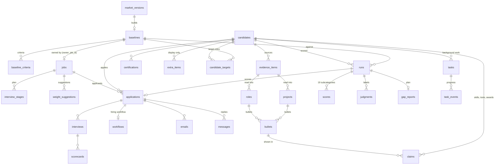

# Database schema

One SQLite file per environment: `data/demo.db` for the demo and `make live`, `rightstaff.db` for `make dev`
(`RIGHTSTAFF_DB` sets it). Schema version 29 (`PRAGMA user_version`). The latest DDL is in `core/db/schema.py`;
an older database steps forward through `core/db/migrations.py` when it is opened. Ids are UUID strings and
timestamps are ISO-8601 UTC text. Only two foreign keys are declared (`baseline_criteria.baseline_id`,
`evidence_items.candidate_id`); every other link below is by convention, through the id columns shown.

Next to it:
- `<db>.graphs.db`: LangGraph checkpoints (paused onboarding reviews, hiring workflows, Not moving forward drafts),
  keyed by thread id.
- `data/judgment-archive.db`: the synthetic profiles' saved judgments, which `make reseed` replays
  (`scripts/judgment_archive.py`).

## Tables by area

### Baselines and jobs
| Table | Key | What it holds |
|---|---|---|
| `baselines` | `id` | A role profile: title, level, required years, expected reach, scope and complexity expectations. `owner_job_id` set when a published job owns it; `market_version_id` when it was built from market postings. |
| `baseline_criteria` | `id`; FK `baseline_id` | Skills, tools and certifications of a baseline: kind, name, aliases, required or preferred. |
| `jobs` | `id` | A recruiter job: `baseline_id` (the job's own baseline), `role_baseline_id`, weights, must-haves, settings, status (draft / open / closed), the JD and the autosaved draft. |
| `interview_stages` | `id`; `job_id` | The job's interview plan, in order. |
| `weight_suggestions` | `id`; `job_id` | Weight assistant suggestions (specs/21): the recruiter's text, the suggested weights and reasons, applied / undone. |

### Candidates and their evidence
| Table | Key | What it holds |
|---|---|---|
| `candidates` | `id` | A person: name, GitHub username, portfolio and LinkedIn URLs, `data_source` (`archetype`, `demo_parsed`, `test_variant` for synthetic profiles; empty for people who used the app). |
| `evidence_items` | `id`; FK `candidate_id` | One source document: resume, LinkedIn PDF, a GitHub repository, the portfolio. Raw text, file path and hash, the extraction and its status. |
| `roles`, `projects`, `bullets`, `claims`, `certifications`, `references_`, `extra_items` | `id`; `candidate_id`, `evidence_id` | The validated profile. Bullets belong to a role or project; claims (skills, tools, awards) may point at a bullet; `extra_items` are display-only (education, patents, …). Each item keeps its source quote, how it was read (`method`) and the other documents that named it (`sources`). |
| `dropped_items`, `deleted_items`, `suppressed_items` | `id`; `candidate_id` | What validation dropped (with the reason), what the candidate deleted in Review (never re-added) and later mentions of a deleted item ("Add back"). |
| `media_links` | `id`; `candidate_id` | Links the candidate added (talks, demos). |
| `candidate_targets` | (`candidate_id`, `baseline_id`) | Target roles, one primary. |
| `candidate_onboarding` | `candidate_id` | Where the first run is, and its tasks. |
| `candidate_application_details` | `candidate_id` | Work authorization, frequent questions, voluntary self-identification. Read only by `services/candidate.py`. |
| `candidate_job_prefs`, `candidate_plan_done` | composite | Saved / hidden jobs; plan actions marked done. |

### Scoring
| Table | Key | What it holds |
|---|---|---|
| `runs` | `id`; `candidate_id`, `baseline_id` | One scoring run: weights, status, `logic_version`, the baseline's hash, the models used, the scoring date (`scored_on`), timings, plan status. |
| `judgments` | `id`; `candidate_id`, `baseline_id`, `run_id` | Every label a judge gave: question, subject, label, quote, probabilities, reasoning, method and model version, confidence, the input hash it was given for, whether it was used. Reused by input hash. |
| `scores` | `id`; `run_id` | The 19 subcategory scores of a run: score, status (scored / missing / na / error), details and guidance. Dimension and final scores are computed from these (`scoring/aggregate.py`), never stored. |
| `gap_reports` | `id`; `run_id` | Ranked gaps and the improvement plan. |
| `generated_summaries` | (`run_id`, `kind`, `weights_hash`) | Recruiter panel texts per run. |
| `tasks`, `task_events` | `id`; (`task_id`, `seq`) | Background work (onboarding, scoring, plans) and its progress events. |

### Recruiter workflow and email
| Table | Key | What it holds |
|---|---|---|
| `applications` | `id`; `job_id`, `candidate_id`, `run_id`, `stage_id` | A candidate applying to a job, with the run that scored them for it. |
| `workflows`, `workflow_events` | `application_id`; `id` | One hiring workflow per application (its step, round, status) and its history. |
| `interviews`, `scorecards` | `id`; `application_id` | Booked interviews and interviewer ratings. |
| `emails`, `messages` | `id`; `application_id` | Drafted and sent emails (`intended_to` vs `actual_to`: `DEMO_EMAIL_TO` while it is set) and the candidate's replies. |
| `activity`, `job_events` | `id`; `application_id`, `job_id` | The applicant timeline and recruiter activity signals. |

### Market baselines
| Table | Key | What it holds |
|---|---|---|
| `market_postings` | `id` | Job postings per role: source, company, tier, level, text and its hash. |
| `market_extractions` | `text_hash` | One cached extraction per posting text. |
| `market_versions` | `id`; `baseline_id` | A computed market baseline per role and level, draft or published. |
| `market_suggestions`, `market_settings` | `id`; `key` | Name merges waiting for a person; per-role settings (the baseline source). |

### Caches and logs
| Table | Key | What it holds |
|---|---|---|
| `document_texts` | (`file_sha256`, `normalizer`) | Normalized text of an uploaded file; the normalizer string is part of the key, so a change to reading never reuses old text. |
| `extraction_cache` | `key` | Extraction outputs for identical documents. |
| `http_cache` | `key` | GitHub API responses (24 h). |
| `prompt_guard_cache`, `prompt_guard_flags` | | Prompt-injection screen scores per text chunk, and flagged chunks (Admin only). |
| `parser_runs` | `id`; `candidate_id`, `evidence_id` | How each LinkedIn PDF was read in code, or why it went to the LLM. |
| `provider_usage` | (`provider`, `model`, `day`) | Requests and tokens per model per day (free-tier limits, spending caps). |

## Relationships

## Changing the schema

Add the change to `SCHEMA` in `core/db/schema.py` (new databases) and as a step in `MIGRATIONS` in
`core/db/migrations.py` (existing ones), and raise `SCHEMA_VERSION`. `tests/test_db.py` migrates a version-1
database to the latest version and checks its new columns and that its data is kept.
